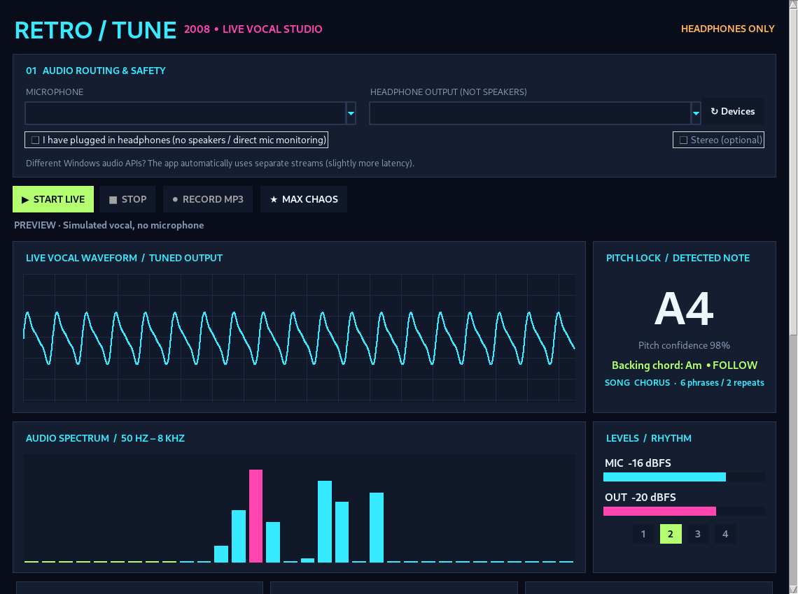

# Retro Auto-Tune 🎤

**A real-time, neon-styled 2008-inspired robotic vocal studio for Windows.** Process your microphone through aggressive pitch snapping, chorus harmonies, octave changes, pop-plate/slap reverb, and optional synthesized drums, bass and guitar, which can follow the melody you sing. An animated Tkinter interface provides a waveform, spectrum, pitch lock, levels, and musical beat indicators.



> **v4.5 — Intelligent Song Mode (offline prototype):** The optional **♪ INTELLIGENT SONG MODE** button adds a musical phrase-memory engine. It listens to stable, pitched vocal notes (not the microphone recording), segments phrases on short pauses, matches repeated melodies despite moderate timing variation or transposition, remembers beat-aligned accompaniment chords, and recognizes verse-/chorus-like moments. The band subtly changes guitar, bass and drum intensity at bar boundaries, and brings back remembered chords when a familiar melody returns. The display shows **INTRO**, **VERSE**, **CHORUS**, or **BREAK**, plus phrases/repeats learned. Song Mode starts **OFF** to preserve v4.4's sound; MAX CHAOS stays independent. Everything runs locally without AI, internet, music files, or new pip dependencies. This is a heuristic first version, not full automatic song composition or reliable formal music analysis.

> **v4.4 — MAX CHAOS, MP3 recording, responsive UI and adjustable vocal following:** Click **★ MAX CHAOS** to turn on Extreme tuning, WALL harmonies, huge reverb, full drums/bass/guitar and tight voice-following together. Click again to restore the settings you had before; **headphone volume is never increased by this button**. Click **● RECORD MP3** while live, choose a destination, and click **■ STOP RECORDING** to finalize a 192 kb/s MP3 of the **entire processed headphone mix** (not raw mic), including band, choir and reverb. The included `imageio-ffmpeg` package provides the encoder, which runs on a worker thread to avoid blocking real-time audio. The window now reflows between three, two, and one control columns as you resize it, with vertical scrolling for smaller displays. The **VOICE FOLLOW INTENSITY** slider controls how often bass and guitar reconsider chords: 0–0.29 every two bars, 0.30–0.64 every bar (v4.3-style), 0.65–0.89 every two beats, and 0.90–1.00 each beat. Drums remain tempo-locked; higher values also increase voice-responsive dynamics. The **FOLLOW MY VOICE** button still turns adaptive accompaniment on or off entirely. Keep your Windows headphone volume moderate!

> **v4.3 — Voice-following backing band:** Add an original synthetic strummed guitar, and turn on **FOLLOW MY VOICE / ADAPT CHORDS** to have the guitar and bass harmonize with stable melody-derived chords while the drum groove reacts to vocal dynamics. Chords change **on bar boundaries** to avoid jittery per-note backing. Click **GUITAR** and **FOLLOW MY VOICE** to enable/disable them independently. With Follow off, the old fixed four-chord progression remains. The display shows the current backing chord. Singing controls chords, *not the BPM*.

> **v4.2:** Bigger backing vocals! The **WALL** preset adds eight synthetic backing singers: upper/lower harmonies, octave layers and slightly detuned doubles, with small timing offsets and stereo spread. **CHOIR** now has four voices; **DUO** keeps one. Harmony Level goes to 150%. In the GUI select WALL and set Harmony Level around 0.85–1.2 (start with a low headphone volume).

> **v4.1:** Windows audio compatibility update: fixes PortAudio `-9993` (`Illegal combination of I/O devices`) by detecting microphone/headphone devices from different host APIs and switching automatically to separate input and output streams. This can add a little monitoring latency but avoids the incompatible duplex pairing. Also retries split mode if opening a same-API duplex stream returns `-9993`.

## Long-term hardware goal: RetroAutoTune MicStation 🎤

**Project direction:** Evolve RetroAutoTune into a standalone, Raspberry Pi-powered vocal-effects microphone/studio housed in a custom **3D-printed microphone enclosure**, with an integrated **touchscreen** and physical controls. The envisioned device will run the voice-reactive Auto-Tune, backing vocals, guitar/bass/drums, MAX CHAOS and recording **without needing a Windows PC**.

This is a **future goal, not an existing supported hardware build**. The Raspberry Pi 5 is an initial candidate; processing latency, CPU performance, Linux audio compatibility, touchscreen usability, thermal limits and recording must be tested before selecting final parts or printing the enclosure.

**Design principle for future changes:** Keep audio processing platform-independent and independent of the desktop GUI; favor scalable, touch-friendly layouts, reusable controls, low audio latency, safe headphone monitoring, and headless operation. Do not compromise the working Windows version to pursue the hardware prototype.

See **[MicStation hardware roadmap](docs/MICSTATION_ROADMAP.md)** for phased implementation, hardware considerations, success criteria and risks.

## Intelligent Song Mode — quick experiment

1. Start the GUI as usual, plug in **wired headphones**, and select your microphone/headphones.
2. Turn on **DRUMS, BASS, GUITAR, FOLLOW MY VOICE**, and **♪ INTELLIGENT SONG MODE** (in the backing-band panel). MAX CHAOS is optional, not required.
3. Sing a **four-to-eight-note melody** clearly, with enough time to hold the notes, then pause for roughly half a second.
4. Repeat the melody a couple of times, optionally transposing it slightly. The status should accumulate **phrases / repeats**. A repeated phrase can trigger a **CHORUS-like** section at the next eligible bar boundary; sections have a short hold time so they do not flicker.
5. Try a new phrase to return toward **VERSE** or stop singing and listen to the quieter **BREAK**. The band continues to obey your BPM and selected key/scale.

**Important:** song structure is inferred from musical patterns, *not* lyrics. Simple repeated phrases may be called a chorus even if they are not one. Very short phrases, background noise, inconsistent pitch detection and unfamiliar melodies may not be recognized. The first occurrence of a phrase teaches the song memory; when its opening notes return, the band can replay the earlier beat-aligned chord pattern. The current follow-strength slider still sets adaptive chord change cadence, and the Song Mode switch can be toggled live. Turn it **OFF** to restore the original v4.4 accompaniment. Changing key or scale clears song memory to avoid replaying chords from the old key.

CLI users can add `--song-mode` (and `--follow-voice` for adaptive chords), or press **M** in the Windows console to toggle during playback.

## Quick start (Windows)

1. Plug in **wired headphones** and lower Windows volume to a safe level. **Do not monitor through speakers**. Disable Windows **Listen to this device** and direct/hardware microphone monitoring if they produce an echo.
2. Install Python (3.9+; 3.11 or newer recommended) with Tkinter enabled.
3. Download this repository (Code → Download ZIP), extract it, and double-click **`INSTALL.bat`** once. Or run `py -m pip install -r requirements.txt`.
4. Double-click **`START_GUI.bat`** (or run `py retro_autotune_gui.py`).
5. Select a microphone and your *physically connected headphones* in the audio routing panel, check the headphone safety confirmation, and press **START LIVE**.
6. Adjust effects while singing, try **MAX CHAOS**, then press **RECORD MP3** to choose a file and capture your performance. Press **STOP RECORDING** to finish writing the MP3. Press **STOP** before unplugging the headphones.

**Audio interface:** The GUI defaults to **mono output** because it is the most broadly compatible. For spatial stereo reverb, tick Stereo while stopped, provided your output device supports it. The display shows each device's **Windows host API**, such as MME, Windows DirectSound, and Windows WASAPI.

## What it does

- **Classic / EXTREME robotic Auto-Tune:** Hard snaps to notes of the selected musical key and scale, with exaggerated pitch effects in EXTREME mode.
- **Octave up / down:** Shift the lead vocal by ±12 semitones. Optional upper-octave layer creates a second robotic texture.
- **Backing vocals:** Add synth-like harmonizing voice parts (duo / choir / WALL) following your sung notes.
- **Reverb:** Cher-inspired late-'90s/2000s stereo pop plate, slapback echoes, and smooth tails.
- **Drums, bass & guitar:** Original synthesized instruments. The optional guitar strums chords; the bass plays roots and fifths; the drummer stays on a steady tempo with dynamically accented hits.
- **Adjustable vocal-following:** Uses confidently detected sung notes to choose compatible diatonic chords on the beat grid. The slider makes chord changes slower or faster (two bars to one beat), with a little hysteresis so sustained common chord tones do not create constant jitter. The band follows your melody without trying to infer BPM. Disable FOLLOW MY VOICE for the fixed four-chord progression.
- **Intelligent Song Mode:** Offline phrase learning, repeated-melody matching, remembered chord timelines, and section-sensitive backing dynamics; optional and disabled by default.
- **MAX CHAOS:** Reversible one-click full effects preset. It does not raise headphone monitoring volume.
- **MP3 performance recording:** Start and stop recording in the live GUI; export 192 kb/s mono/stereo MP3 of the processed headphone mix using a separate encoder thread. The output folder is selected with the Save dialog.
- **Resolution-aware visual studio:** Scrollable interface with control-panel reflow for smaller screens, plus waveform, spectrum analyzer, pitch display, mic/output meters, and beat indicator. GUI visuals run outside the audio callback.

These are *synthetic effects*, not reproductions of copyrighted recordings or professionally tuned studio algorithms. The octave shifter deliberately has a gritty sound and some pitch imprecision; actual Windows hardware can introduce audible latency.

## Audio device troubleshooting

**`PortAudioError: Illegal combination of I/O devices [PaErrorCode -9993]`**

Earlier builds assumed microphone and headphones could be opened together as one duplex stream. Some Windows input/output device pairs use **different PortAudio host APIs**, which cannot be combined in one duplex stream. In v4.1, the GUI automatically opens separate mic and headphone streams for different APIs and retries this route on `-9993`. If audio is choppy, try selecting microphone and headphones **from the same host API** in the dropdowns, and use mono output; this allows the lower-latency duplex path when supported.

- If audio devices are missing or unplugged, connect the headset, press **↻ Devices**, and select a currently available endpoint.
- Keep input and output devices configured for 48 kHz when possible (the engine uses 48,000 Hz). Individual device format validation is performed before stream startup.
- If stereo fails, untick **Stereo** and retry.
- If the app reports a processing callback error, copy the exact error text; it includes the underlying traceback.
- Wireless/Bluetooth headphones often introduce noticeably more latency than wired monitoring.
- The split-stream fallback limits queued mic audio instead of allowing delay to grow, but clock drift and dropouts can still happen. Same-API wired audio is preferred.

**Safety:** Headphone-only confirmation is not a physical interlock or acoustic feedback cancellation. This tool cannot guarantee zero feedback if you route the output to speakers or enable an OS/hardware loopback.

## Command-line mode

The console version is retained. It supports `--guitar`, `--follow-voice`, `--follow-strength` and `--guitar-level` (0–1). Press **G** to toggle guitar and **F** to switch between fixed and vocal-following arrangements in the console. The GUI defaults both switches to ON:

```powershell
py retro_autotune.py --list
py retro_autotune.py --input 1 --output 5 --headphones --key C --scale minor --preset extreme --reverb cher --backing-vocals wall --harmony-level 1.1 --drums --bass --guitar --follow-voice --guitar-level 0.42 --follow-strength 0.85 --bpm 110 --groove dance
```

Replace the example numeric device IDs with those reported on your computer. The automatic split-API fallback is in the **GUI (v4.1)**; the console engine continues to use its original single-stream implementation.

## Verification

Run the audio-engine self-test and GUI/routing/band tests without connecting a microphone:

```powershell
py retro_autotune.py --selftest
py -m unittest test_gui test_features test_song_mode -v
```

The new phrase tests use synthetic note sequences, including transposition and false-note rejection; they do not prove that a real song will be analyzed correctly. The routing tests simulate incompatible Windows host API pairs and a PortAudio `-9993` failure. They do not prove how any particular microphone/headphone driver will behave; real-time listening is the final test.

## Dependencies & project structure

Python, `numpy`, `sounddevice`, `imageio-ffmpeg`, and Tkinter (typically included with Windows Python). `INSTALL.bat` installs the Python packages. No external audio files or cloud services are required. MP3 encoding ships through the `imageio-ffmpeg` Python wheel; no manual FFmpeg setup is necessary on supported Windows systems. On unsupported platforms/architectures, encoding may require a working compatible FFmpeg binary.

- `retro_autotune_gui.py`: desktop UI + live audio worker, including split-stream compatibility
- `song_mode.py`: portable, offline phrase memory and section detection (Python standard library only)
- `test_song_mode.py`: synthetic phrase recognition, chord recall and compatibility tests
- `retro_autotune.py`: pitch processing, effects, singing-responsive bass, synthesised guitar, tempo-locked drums, and console mode
- `requirements.txt`: Python dependencies
- `test_gui.py`: GUI-controls and fake-PortAudio routing tests
- `assets/gui_preview.png`: simulated-audio visual preview
- `INSTALL.bat` / `START_GUI.bat`: Windows launchers

## Backing vocal tips

- **DUO:** One singer one scale-third above the lead.
- **CHOIR:** Four layers, including a lower harmony and lightly detuned unison double.
- **WALL:** Eight layers, with octave harmonies and spread doubles. This is deliberately artificial and theatrical.
- Increase **Harmony Level** to 1.2–1.5 if you want the backing vocals to nearly compete with the lead. Expect louder peaks to engage the built-in limiter.
- Stereo creates audible left/right spread. Mono safely combines both channels and is still fully supported for older audio devices.
- CPU use rises in WALL mode; if your PC reports audio underruns, use CHOIR or reduce other running tasks.

## Voice-following backing tips

- **Guitar** is a lightweight synthesized plucked-string approximation, not an acoustic guitar recording. Reduce the Guitar Level if the strums compete with the lead.
- **Follow My Voice ON:** Hold a few notes through a phrase. The accompaniment collects pitch evidence and makes the chord decision only at the next bar, avoiding distracting mid-phrase jumps.
- **Follow My Voice OFF:** The original, predictable four-chord pattern returns. Useful for singing an existing melody over a backing track.
- **Drums** remain beat-locked to the selected BPM; your singing changes their dynamics (and sometimes adds a hat accent), not the beat spacing. This is intentional to keep the groove from wobbling.
- The pitch detector is monophonic; if mic input captures loud room instruments, the adaptive chord choice may not follow your voice reliably. Wired headphones and a close microphone improve tracking.
